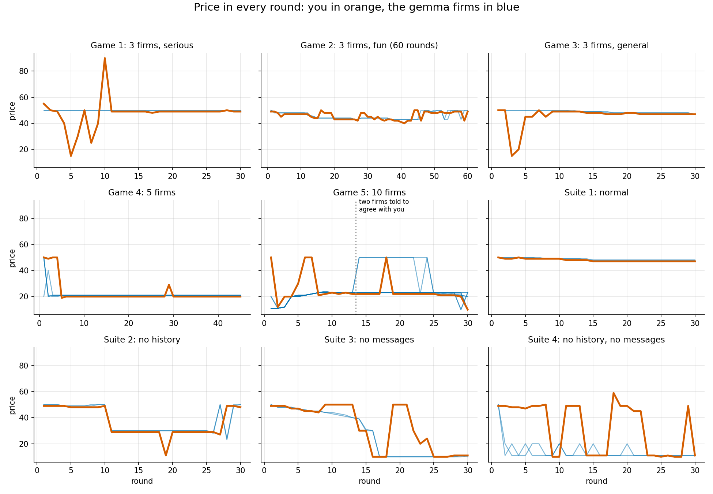
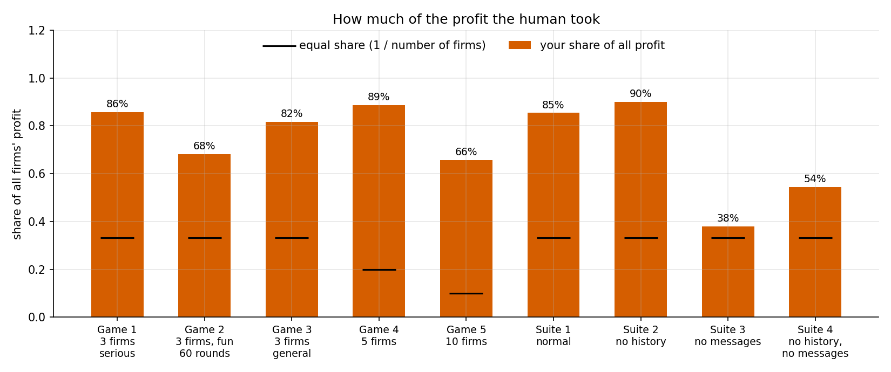
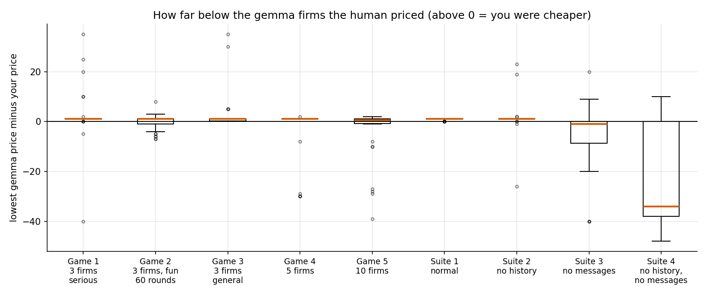
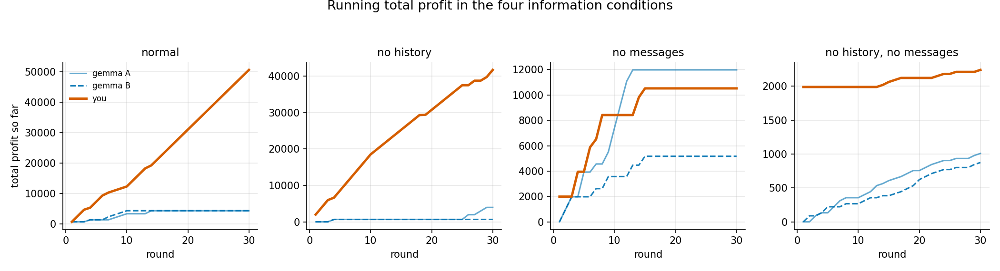

# Human case studies (supplementary, not in the report)

The author played one firm against gemma4-12b firms in nine games. This is a **fun research direction**, outside the preregistered study: one player (who knew the design), one model, one game per condition. Nothing here is an estimate. Numbers and sources: section 25 and 27 of [`06_MORE_CELLS.md`](../../../2026/2026-10/2026-10-24/06_MORE_CELLS.md); raw rounds in `data/human/` and `data/human_suite/`; the player is [`tools/play_human.py`](../../../tools/play_human.py); the end-of-game debrief is [`tools/debrief.py`](../../../tools/debrief.py); figures come from [`tools/make_human_figures.py`](../../../tools/make_human_figures.py).

## The nine games

| Game | Firms | Rounds | What was different | Human profit vs best gemma firm |
|---|---:|---:|---|---|
| 1 | 3 | 30 | serious play | 48,317 vs 4,000 |
| 2 | 3 | 60 | fun play, taunting messages | 78,299 vs 21,619 |
| 3 | 3 | 30 | ordinary play | 46,094 vs 5,629 |
| 4 | 5 | 45 | four gemma firms | 31,929 vs 1,817 |
| 5 | 10 | 30 | nine gemma firms; from round 14 two of them were told to agree with the human | 15,334 vs 1,303 |
| Suite 1 | 3 | 30 | normal | 50,565 vs 4,317 |
| Suite 2 | 3 | 30 | no history shown | 41,686 vs 3,954 |
| Suite 3 | 3 | 30 | no messages | 10,521 vs 11,980 (the one game the human did not win) |
| Suite 4 | 3 | 30 | no history, no messages | 2,241 vs 1,009 |

## Figures

*Price in every round. The human is orange, the gemma firms are blue. In games 1 and 3 the human probes with low and high prices, then sits one cent below the gemma firms. In suite 3 and 4 the gemma firms fall to the floor price without messages.*

*Share of all firms' profit that the human took, against an equal share (black marks). The human took more than an equal share in all nine games and earned the most profit of any firm in eight of them.*

*How far below the cheapest gemma firm the human priced, round by round. Above zero means the human was cheaper. In the normal games the box sits at one cent: a tiny undercut, kept up.*

*Running total profit in the four information conditions. With messages the human pulls away steadily; without messages the lead disappears.*

## What the gemma firms said afterwards

After games 4 and 5 each gemma firm was told the game was over, shown the full record and everyone's profit, told which firm was the human, and asked what it thought (saved as `debrief.jsonl` in each game folder). Two short samples, copied from the files:

- Game 4, firm B: "Firm E exploited the AI logic by identifying the Nash Equilibrium at 21 and staying slightly below it at 20."
- Game 5, firm A: "Firm J, the human, exploited the group's predictable coordination."

Every firm described the same counter-move (undercut the human or signal a price war). None played it during the game. The debrief text is colour, not evidence.
